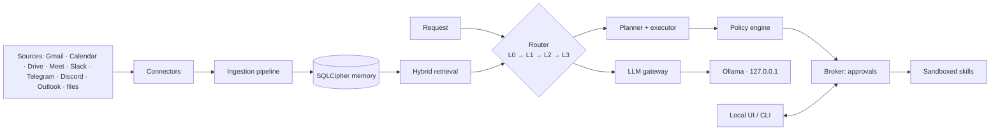

# Ragnarok

**A sovereign, always-on personal AI agent that runs entirely on your own machine.**


Ragnarok reads your **mail, calendar, files and chats**, remembers them **with provenance**, plans and executes multi-step tasks through **sandboxed skills** — and never sends, deletes or changes anything outside its workspace **without a click bound to the exact content**.

Local models. Encrypted memory. Zero Trust. Every write gated behind a click.

---

## Why Ragnarok?

Five principles guide every feature:

| Pillar | What it means |
|---|---|
| **Sovereignty you can prove** | One data directory, loopback-only services, an egress allowlist, packet-capture evidence, and an offline demo. |
| **Memory with provenance** | Eleven memory types in a single encrypted file; every fact links to a quote in a source; delete cascades and is verified by a scan. |
| **Safe autonomy** | Zero Trust: the model is assumed already tricked. Code-enforced policy, sandboxing, taint tracking, and content-bound approvals. |
| **Fast by design** | A confidence-gated cascade; most decisions never reach a generative model, and the cascade learns from its own successes. |
| **Evidence, not claims** | Every number comes from this project's own harness, per machine, merged into `docs/EVIDENCE.md`. |

---

## What it does

- **Ingests** Gmail, Google Calendar, Drive, Meet, Slack, Telegram, Discord, Outlook, local files, and desktop notifications.
- **Remembers** everything in an encrypted SQLCipher store with provenance, bitemporal facts, and hash-chained events.
- **Routes** every request through a four-tier cascade (learned routes → Laya → small model → big model), so repeat tasks get faster.
- **Plans and executes** multi-step tasks with crash recovery and self-correction.
- **Guards every write** behind an approval card bound to the exact content — sends, deletes and edits happen only when you click.
- **Serves a local UI** (always-on-top window) plus a CLI for everything.

---

## How it works

### The four-tier router

| Tier | Component | Handles |
|---|---|---|
| **L0** | Route library | Previously-verified routes matched by embedding similarity. No model call. |
| **L1** | Laya (local classifier) | Skill family, injection and risk pre-checks in one forward pass. |
| **L2** | Small Ollama arbiter | Interprets ambiguous requests and picks skills. |
| **L3** | Big Ollama planner | Plans genuinely complex or multi-step work. |

When a task succeeds, the route that worked becomes a **candidate**, is verified in **shadow mode**, and is promoted into **L0** — so the same kind of request is served faster next time. This is the self-improving loop.

### Zero Trust

- The model is treated as **already manipulated**.
- Every non-human actor has an identity; skills are **hash-verified** at execution time.
- **Taint tracking**: untrusted content can never trigger a sensitive action on its own.
- Egress allowlist, gateway scanning, canaries, budgets, and step-up approval for critical actions.



---

## Quickstart

### macOS

```bash
brew install uv git
# install the Ollama app from ollama.com

git clone https://github.com/IshanGite/kala-dhua.git
cd kala-dhua
uv sync --extra laya --extra window
ollama pull nomic-embed-text
ollama pull qwen3:1.7b
ollama pull qwen3:4b
uv run ragnarok doctor
```

### Windows

```powershell
winget install astral-sh.uv Git.Git Ollama.Ollama

git clone https://github.com/IshanGite/kala-dhua.git
cd kala-dhua
uv sync --extra laya --extra window
ollama pull nomic-embed-text
ollama pull qwen3:1.7b
ollama pull qwen3:4b
uv run ragnarok doctor
```

`uv run ragnarok doctor` is the **sync tool**: run it after every pull, on every machine. `uv run ragnarok check` is the pre-push gate.

### Run it

```bash
uv run ragnarok run       # always-on agent + local API (no window)
uv run ragnarok window    # always-on-top chat/activity window with an on/off switch
```

On an empty store the agent answers *"I don't have anything about that in memory yet"*.

---

## CLI

| Command | Purpose |
|---|---|
| `ragnarok doctor [--benchmark] [--restore-test]` | Check this machine. Run after every pull. |
| `ragnarok check` | Lint + fast tests (the pre-push gate). |
| `ragnarok run [--port] [--interval] [--folder]` | Start the always-on agent + local API. |
| `ragnarok window [--port] [--no-top]` | Start the always-on-top window. |
| `ragnarok connect slack\|telegram\|discord` | Store a bot token in the OS keychain. |
| `ragnarok connect google --client-file <json> [--write]` | Google OAuth sign-in (Gmail, Calendar, Drive, Meet). |
| `ragnarok connect outlook --client-id <id>` | Outlook device-code sign-in. |
| `ragnarok version` | Print the version. |

---

## Connectors

Read and write tokens are **separate**; tokens live in the OS keychain, never in a file. Read comes first, write is a second opt-in.

| Source | Read | Write (click-gated) |
|---|---|---|
| Gmail | ✅ | Draft, reply in thread, send |
| Google Calendar | ✅ | Create event |
| Google Drive | ✅ | Create document |
| Google Meet | ✅ (transcripts) | — |
| Slack | ✅ (polling) | Posting not enabled yet |
| Telegram | ✅ | Send message |
| Discord | ✅ | Post in channel |
| Outlook | ✅ (coded, not yet live-tested) | Draft & send (designed) |
| Local files | ✅ | — |
| Desktop notifications | Built, not yet live-tested | — |

See **[`docs/CONNECTOR_SETUP.md`](docs/CONNECTOR_SETUP.md)** for the exact console steps for every source.

---

## Models

Pinned in [`models.lock`](models.lock) (name + digest); the daemon refuses a model whose digest differs.

| Role | Model |
|---|---|
| Embeddings | `nomic-embed-text` |
| Writer (chat & drafts) | `qwen3:0.6b` |
| Arbiter (L2) | `qwen3:1.7b` |
| Planner (L3) | `qwen3:4b` |

No cloud AI service, SDK, key or endpoint. Generation and embeddings go only to Ollama on `127.0.0.1:11434`.

---

## Security & privacy

- **Local first** — no cloud AI, no telemetry, egress allowlisted and auditable.
- **Encrypted at rest** — SQLCipher, per-file AES-GCM blobs, secrets only in the OS vault.
- **Zero Trust** — identities, hash-verified skills, taint tracking, gateway scanning, canaries, budgets, step-up approval.
- **Reversible** — deletes go to trash, snapshots before bulk changes, an undo window on every write.
- **Evidence** — `tests/security/` doubles as the red-team suite (SEC-01 … SEC-20).

---

## Repository layout

```
kala-dhua/
├─ src/ragnarok/          # the agent itself
│  ├─ core/               # clock, ids, errors, logging, failpoints
│  ├─ store/              # SQLCipher db, crypto, migrations, vectors
│  ├─ memory/             # 11 memory types, retrieval, delete, retention
│  ├─ llm_gateway/        # the only path to models
│  ├─ router/             # L0→L1→L2→L3 cascade + route library
│  ├─ harness/            # planner, executor, verifier, recovery
│  ├─ policy/             # declarative rules (fail closed)
│  ├─ broker/             # click-gated approvals
│  ├─ security/           # guard, vault, canaries, snapshots
│  ├─ sandbox/            # seatbelt / container / windows backends
│  ├─ connectors/         # gmail, calendar, drive, meet, slack, telegram, discord, outlook, files
│  ├─ ingest/             # queue + parse + sanitize + chunk + index
│  ├─ daemon/             # always-on runtime + local API
│  └─ skills/             # builtin + native skills (hash-verified)
├─ ui/                    # the always-on-top window (single HTML page)
├─ tests/                 # unit, contract, security suites
├─ scripts/               # spikes, evals, e2e
├─ docs/                  # architecture, build plan, ADRs, spikes, setup
├─ evidence/              # measured results
├─ models.lock            # pinned model names + digests
├─ pyproject.toml         # dependencies + the ragnarok entry point
└─ CLAUDE.md              # operating rules for the build
```

---

## Documentation

- [`docs/ARCHITECTURE.md`](docs/ARCHITECTURE.md) — what and why; locked decisions **D-01 … D-30**.
- [`docs/BUILD_PLAN.md`](docs/BUILD_PLAN.md) — the ordered, testable build plan with gates.
- [`CLAUDE.md`](CLAUDE.md) — operating rules for the build (binding).
- [`docs/CONNECTOR_SETUP.md`](docs/CONNECTOR_SETUP.md) — step-by-step connector setup.
- [`docs/HANDOVER_TUSHAR.md`](docs/HANDOVER_TUSHAR.md) — Windows handover and honest gap list.
- [`docs/BRIEF_MID_EVAL.md`](docs/BRIEF_MID_EVAL.md) — measured numbers, security posture, and the demo script.
- [`docs/adr/`](docs/adr/) — one decision record per deviation.
- [`docs/spikes/`](docs/spikes/) — measured spike results (Laya, Ollama, calibration).

---

## Status

Under active construction for a hackathon deadline of **09:00 IST, 26 October 2026**.

**Done (verified live on real accounts):** encrypted store + memory service, Zero Trust layer, executor with crash recovery, router + route library, read-side connectors (Gmail, Calendar, Drive, Meet, Slack, Telegram, Discord), the always-on window, and click-gated actions (email, calendar, Drive, Telegram, Discord).

**Honest gaps:** Windows sandbox backends and notification reader, Laya fine-tuning, Outlook and notifications on real accounts, Slack posting permission, the full red-team report, and the memory explorer / delete preview / route library screens in the window.

See [`docs/HANDOVER_TUSHAR.md`](docs/HANDOVER_TUSHAR.md) for the full list.

---

## Prior work

Connector parsing and polling logic is adapted from the [groupify](https://github.com/abhi-dev99/groupify) project, with all cloud-model and hosted-service dependencies removed.
