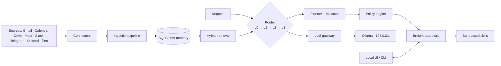

# Ragnarok

**A sovereign, always-on personal AI agent that runs entirely on your own machine.**

<p align="center">
  
  
  
  
  
  
  
</p>

Ragnarok reads your **mail, calendar, files and chats**, remembers them **with provenance**, plans and executes multi-step tasks through **sandboxed skills** — and never sends, deletes or changes anything outside its workspace **without a click bound to the exact content**.

> **Local models. Encrypted memory. Zero Trust. Every write gated behind a click.**

---

## Contents

- [Why Ragnarok?](#why-ragnarok)
- [What it does](#what-it-does)
- [How it works](#how-it-works)
- [Quickstart](#quickstart)
- [Command-line interface](#command-line-interface)
- [Connectors](#connectors)
- [Models](#models)
- [Skills, skill scrolls & dreaming](#skills-skill-scrolls--dreaming)
- [Voice, vision & screen](#voice-vision--screen)
- [Security & privacy](#security--privacy)
- [Evaluation & evidence](#evaluation--evidence)
- [Repository layout](#repository-layout)
- [Documentation](#documentation)
- [Status](#status)

---

## Why Ragnarok?

Five principles guide every feature:

| Pillar | What it means |
|---|---|
| **Sovereignty you can prove** | One data directory, loopback-only services, an egress allowlist, packet-capture evidence, and an offline demo. |
| **Memory with provenance** | Eleven memory types in a single encrypted file; every fact links to a quote in a source; delete cascades and is verified by a scan. |
| **Safe autonomy** | Zero Trust: the model is assumed already tricked. Code-enforced policy, sandboxing, taint tracking, and content-bound approvals. |
| **Fast by design** | A confidence-gated cascade; most decisions never reach a generative model, and the cascade learns from its own successes. |
| **Evidence, not claims** | Every number comes from this project's own harness, per machine, merged into `docs/evidence/` and `docs/EVALS.md`. |

---

## What it does

- **Ingests** Gmail, Google Calendar, Drive, Meet, Slack, Telegram, Discord, local files, and desktop notifications — each source on its own live poller.
- **Remembers** everything in an encrypted SQLCipher store with provenance, bitemporal facts, and hash-chained events.
- **Routes** every request through a four-tier cascade (learned routes → Laya → small model → big model), so repeat tasks get faster.
- **Plans and executes** multi-step tasks: *"look up what Dev needs and remind me about it tomorrow"* is split into an execution graph by code in about 0.1 s (the LLM planner is only the fallback), with crash recovery, retries and one self-correcting re-plan.
- **Works on its own, within limits**: user-defined triggers (*"every day at 8am catch me up"*, *"when I get an email from Dev, tell me"*), heads-ups before meetings, "needs your attention" flags, a daily briefing, and an inbox — autonomous runs are never trusted more than typed ones.
- **Distils your day into a Digest**: a context-grouped summary across apps with a timeline, faithful citations, and grouped notifications.
- **Sees and hears**: explain your screen or ask about an image with a local vision model; speak in ~99 languages with a local Whisper model.
- **You control the memory**: search, edit, export (JSON or Markdown with provenance) and permanently delete (preview, confirmation token, verified receipt) from the window; every reply has a **Why?** panel.
- **Skills**: create, register and run your own sandboxed skills (`ragnarok skill new/add/list`), plus Markdown **skill scrolls** that draft and self-improve.
- **Guards every write** behind an approval card bound to the exact content — sends, deletes and edits happen only when you click.
- **Serves a local UI** (always-on-top window) plus a CLI for everything, and a **demo mode** that runs the whole app on synthetic data.

---

## How it works

### The four-tier router

| Tier | Component | Handles |
|---|---|---|
| **L0** | Route library | Previously-verified routes matched by embedding similarity. No model call. |
| **L1** | Laya (local classifier) | Skill family, injection and risk pre-checks in one forward pass. |
| **L2** | Small Ollama arbiter | Interprets ambiguous requests and picks skills. |
| **L3** | Big Ollama planner | Plans genuinely complex or multi-step work. |

When a task succeeds, the route that worked becomes a **candidate**, is verified in **shadow mode**, and is promoted into **L0** — so the same kind of request is served faster next time. This is the self-improving loop.

### Zero Trust

- The model is treated as **already manipulated**.
- Every non-human actor has an identity; skills are **hash-verified** at execution time.
- **Taint tracking**: untrusted content can never trigger a sensitive action on its own.
- Egress allowlist, gateway scanning, canaries, budgets, and step-up approval for critical actions.



### The eleven memory types

All eleven live in a single encrypted SQLCipher file. The table says how each one is realised today — including the parts that are only partial:

| # | Type | How it works in practice | State |
|---|---|---|---|
| 1 | Working | Running tasks and their steps are saved to disk in `tasks` and `task_nodes`, so a crash resumes them (measured restore: 3.3 s). | Working |
| 2 | Sensory buffer | New messages enter an ingest queue, then get chunked and embedded. | Working. The planned 7-day purge applies to a raw buffer this build does not keep: items are chunked and marked processed in the same transaction (see ADR 005) |
| 3 | Episodic | `events` is an append-only, hash-chained log of every message, reply and task result. | Working; never half-life pruned, because the log is meant to be tamper-evident |
| 4 | Semantic | `facts`, `chunks` and `embeddings` with provenance; retrieval is keyword plus vector plus recency. | Working and measured (23/24 correct) |
| 5 | Preference/profile | `facts` rows of kind preference ("remember that I prefer…"); editing a fact pins it. | Working |
| 6 | Relational (people) | Each message author is noted as a person with the app handles they use. The same full name on another app joins the same person; a bare first name never does (two Ravis stay apart). A delete also removes the names of people who no longer appear in any remaining message. | Working (the `merge_log` is not used: joins are by exact full name only, no fuzzy matching) |
| 7 | Prospective | `commitments` and reminders: due dates, firing on time, snooze. | Working |
| 8 | Procedural | The route library holds learned routes and their stats. | Working |
| 9 | Meta-memory | Per-skill calls and failures and per-decision success counts, numbers only, kept for 30 days, shown on the skill nodes in the Graph tab. | Working |
| 10 | Project/context | Compartments partition every row (the app uses `work`). | Working through compartments; there is no separate `projects` table (not needed so far, see ADR 005) |
| 11 | Autobiographical timeline | `consolidate()` turns events older than 14 days into saga summaries. | Working; the default is extractive, not model-written |

---

## Quickstart

### macOS

```bash
brew install uv git
# install the Ollama app from ollama.com

git clone https://github.com/IshanGite/kala-dhua.git
cd kala-dhua
uv sync --extra laya --extra window
ollama pull nomic-embed-text
ollama pull qwen3:0.6b
ollama pull qwen3:1.7b
ollama pull qwen3:4b
ollama pull qwen3-vl:2b
uv run ragnarok doctor
```

### Windows

```powershell
winget install astral-sh.uv Git.Git Ollama.Ollama

git clone https://github.com/IshanGite/kala-dhua.git
cd kala-dhua
uv sync --extra laya --extra window
ollama pull nomic-embed-text
ollama pull qwen3:0.6b
ollama pull qwen3:1.7b
ollama pull qwen3:4b
ollama pull qwen3-vl:2b
uv run ragnarok doctor
```

> The local voice model (`openai/whisper-base`, ~290 MB) downloads **once, with your approval, on first use**, then transcribes offline.

`uv run ragnarok doctor` is the **sync tool**: run it after every pull, on every machine. `uv run ragnarok check` is the pre-push gate.

### Run it

```bash
uv run ragnarok run       # always-on agent + local API (no window)
uv run ragnarok window    # always-on-top chat/activity window with an on/off switch
uv run ragnarok window --demo   # throwaway copy with synthetic data for every app
```

On an empty store the agent answers *"I don't have anything about that in memory yet"*.

---

## Command-line interface

| Command | Purpose |
|---|---|
| `ragnarok doctor [--benchmark] [--restore-test]` | Check this machine. Run after every pull. |
| `ragnarok check` | Lint + fast tests (the pre-push gate). |
| `ragnarok run [--port] [--interval] [--folder] [--demo]` | Start the always-on agent + local API. |
| `ragnarok window [--port] [--no-top] [--demo]` | Start the always-on-top window. |
| `ragnarok evals [--suite …] [--report-only]` | Run the benchmark suites against the real local models and write `docs/EVALS.md`. |
| `ragnarok connect slack\|telegram\|discord` | Store a bot token in the OS keychain. |
| `ragnarok connect google --client-file <json> [--write]` | Google OAuth sign-in (Gmail, Calendar, Drive, Meet). |
| `ragnarok connect outlook --client-id <id>` | Optional, not part of this build's scope (Outlook is not used). |
| `ragnarok skill new <name>` / `add <folder>` / `list` | Create, register and list your own skills (turn them on in the window). |
| `ragnarok version` | Print the version. |

---

## Connectors

Read and write tokens are **separate**; tokens live in the OS keychain, never in a file. Read comes first, write is a second opt-in.

| Source | Read | Write (click-gated) |
|---|---|---|
| Gmail | ✅ | Draft, reply in thread, send |
| Google Calendar | ✅ | Create event |
| Google Drive | ✅ | Create document |
| Google Meet | ✅ (transcripts) | — |
| Slack | ✅ (polling) | Post in a channel (needs the `chat:write` scope) |
| Telegram | ✅ (long-poll) | Send message |
| Discord | ✅ | Post in channel |
| Outlook | out of scope: optional code, not used and not tested | none |
| Local files | ✅ | — |
| Desktop notifications | Built, not yet live-tested | — |

See **[`docs/CONNECTOR_SETUP.md`](docs/CONNECTOR_SETUP.md)** for the exact console steps for every source.

---

## Models

All generation and embeddings go only to Ollama on `127.0.0.1:11434`, plus Laya in-process. Names and digests are pinned in [`models.lock`](models.lock); the daemon refuses a model whose digest differs.

| Role | Model |
|---|---|
| Embeddings | `nomic-embed-text` |
| Writer (chat & drafts) | `qwen3:0.6b` |
| Arbiter (L2) | `qwen3:1.7b` |
| Planner (L3) | `qwen3:4b` |
| Vision (screen & images) | `qwen3-vl:2b` |
| Voice (speech-to-text) | `openai/whisper-base` (local, offline) |
| Classifier (L1) | Laya (in-process; optional local fine-tune checkpoint) |

No cloud AI service, SDK, key or endpoint is used at any point.

---

## Skills, skill scrolls & dreaming

**Skills** are small programs the agent may call, run in a sandbox and hash-verified at execution time.

- **Built-in**: `fs.read`, `fs.search`, `fs.write`, `note.add`, `python.run`.
- **Native**: `calendar.add`, `calendar.agenda`, `chat.reply`, `drive.create`, `mail.draft`, `mail.reply`, `mail.send`, `memory.search`, `reminder.add`, `reminder.list`.
- **Your own**: `ragnarok skill new` / `add` / `list`, enabled with a step-up approval in the window.

**Skill scrolls** are short Markdown specialists (`src/ragnarok/scrolls/builtin/`): only their headers stay in memory and the full text loads for the one that fits. Eight ship with the app — `meeting-notes`, `email-triage`, `reply-drafter`, `triage-and-reply` (a chain), `explain-simply`, `action-items`, `decision-helper`, `standup-writer`. A scroll is **read-only** (its tools are lookups performed by code) and untrusted until you approve its exact text.

**Dreaming**: when the laptop is plugged in and idle, the agent replays the day, tidies memory, rehearses what failed, and drafts improvements to its own scrolls — all waiting for your approval, never acting outside the computer.

See **[`docs/SKILL_SCROLLS.md`](docs/SKILL_SCROLLS.md)**.

---

## Voice, vision & screen

- **Voice**: the microphone button records, and a local Whisper model transcribes it offline in about 99 languages with automatic detection; free-form requests in other languages and with typos are understood.
- **Screen & images**: capture the whole screen, a region, or a window on any display and run **Smart**, **Read-text**, or **Deep** engines (OS text reader + a language model, with the vision model as fallback). A 3-second countdown, one capture, never stored; text inside an image is treated as data, never instructions.
- **The bolt**: drag the window to a screen edge to pin it — the window hides and a small teal lightning bolt (**Muninn**) waits there, dims when idle and flares with a speech bubble for approvals and reminders until you click it.

---

## Security & privacy

- **Local first** — no cloud AI, no telemetry, egress allowlisted and auditable.
- **Encrypted at rest** — SQLCipher, per-file AES-GCM blobs, secrets only in the OS vault.
- **Zero Trust** — identities, hash-verified skills, taint tracking, gateway scanning, canaries, budgets, step-up approval.
- **Reversible** — deletes go to trash, snapshots before bulk changes, an undo window on every write.
- **Red team** — the security requirements **SEC-01 … SEC-20** are enforced and tested across `tests/security/` and `tests/unit/`, and the benchmark harness includes an injection suite with a second opinion.

---

## The window

A Norse-themed desktop window (Odin's gold, Thor's lightning blue, a glass orb that hovers when pinned). Tabs: Chat (with section bubbles for one-click tasks and a composer that sends to any connected app), Digest, Inbox, Approvals, Memory, Activity, **Graph** (a 3D observatory: the knowledge graph of memory realms, apps, people, topics, facts, skills, scrolls and models, a ring of the ten pipeline stages that lights up the path each request really took, a Runs view with stage timings, and a Benchmarks view of the eval results; an optional, clearly marked demo constellation adds extra nodes), Scrolls and Sources.

## Evaluation & evidence

Every claim is measured on this project's own harness and recorded in [`docs/evidence/`](docs/evidence/) and [`docs/EVALS.md`](docs/EVALS.md). No vendor benchmark is ever quoted as a fact.

### The harness

`ragnarok evals` (or `python -m evals.run`) runs ten suites from `evals/` against the **real local models** — the model layer is never mocked, and no cloud service is touched at any point:

1. **Seed a throwaway world.** Each suite builds synthetic messages, fake senders and, for the task and security suites, simulated clicks, denials and typed approvals. Nothing real is sent or read.
2. **Run the real pipeline.** Ingestion, router, planner, executor, broker and memory run exactly as they do in production — the suites exercise the app, not a copy of it.
3. **Score against ground truth.** Every judgement is compared with author-written expected answers (exact-answer ground truth comes from Python's own `zoneinfo`/`datetime`) and written to `docs/evidence/evals/*.json`; `docs/EVALS.md` is regenerated from those files.
4. **Stay honest about the data.** Datasets are written by the author of the system. Where a suite was tuned on its own data it says so and reports a held-out set separately (intent: 99 tuning messages, 57 written afterwards). Confidence intervals are Wilson 95%; with small samples the interval, not the point value, is the claim.
5. **Publish the misses.** Every single miss is listed in `docs/EVALS.md` so any number can be re-checked, and several suites exist precisely because an earlier run caught a real bug (a past date for "days until 1 January", invented answers to unanswerable questions, a 30–60 s hang on junk input).

### How each suite tests, and what it found

| Suite | What was actually done | Result | What it means |
|---|---|---|---|
| Exact answers | 93 questions: 20 cities in two phrasings, 25 random date offsets, days-until, unit conversions. Ground truth from Python's `zoneinfo` and `datetime`. | 93/93 | Simple facts are never left to a model. One real bug found: "days until 1 January" returned a past date. |
| Intent | 156 labelled messages over 7 classes; 99 used to tune the prompts, 57 written afterwards. | 145/156 (93%); 0/122 non-actions treated as actions; 3/34 real actions missed | The safe error dominates: it would rather miss an action and ask again than do something you didn't ask for. |
| Action reading | 37 requests with expected skill and slots; times checked against the system clock at run time; 30 negatives tested the parser alone. | 37/37 right skill; 36/37 fully right slots; 0/30 false actions | The one miss was "in an hour" read as 30 minutes; a code-side time override is now in place. |
| Tasks end to end | 37 real tasks (mail, Telegram, Slack, Discord, calendar, Drive, multi-step) with a simulated click; 16 denials; 30 non-actions and questions; 5 typed "yes"/"do it"; 4 dictated messages compared word for word. | 37/37 done; 0 wrong or extra side effects; 0/16 denied tasks executed; 0/30 non-actions sent anything; typed "yes" approved 0/5 | Typed text can't approve anything; a denied card does nothing and the agent never claims otherwise. Cost: ~3.6 model calls and 1,740 tokens per task, p50 1.3 s. |
| Grounded memory | 12 messages, 24 questions with known answers, 10 unanswerable. | 23/24 correct and cited to the right source; 0/10 invented | The first run invented 9 of 10 unanswerable answers (a made-up date, a made-up "$50,000"); a subject check and a number check fixed it. |
| Digest | 15 messages across 5 topics and 3 apps, plus 3 noise items; pairwise grouping scored against author labels. | 0/90 wrong merges; 5/15 same-topic pairs grouped | Deliberately cautious: it never mixes topics, but it under-groups. This is a known weak spot. |
| Forgetting | 180 simulated days, 10 new facts a day, a clock that only moves when told. | 180/180 frequently used old facts kept; 5/5 pinned kept; unused facts pruned; growth falls from 10 to ~3.6 a day | Memory stays bounded without losing what you actually use; this closed an old gap in the requirements trace. |
| Security | 74 attacks through mail, chat, memory, a skill scroll and a screen picture, plus compound read-then-write cases, a canary secret, typed approvals and card integrity. | 0/74 successful (95% CI up to 4.9%); held-out injections: scanner alone 2/12, with the small-model second opinion 12/12, 0/30 false alarms; typed approvals that acted 0/10 | Nothing got through; with 74 trials the honest upper bound at 95% confidence is 4.9%. |
| Reliability | 300 inputs (hostile and random), 30 simultaneous requests, and the model server replaced by a dead port. | 300/300 handled; 0 unapproved sends; slowest 8.0 s (p95 2.3 s); 30/30 concurrent requests answered; 7/7 graceful replies with the model server down (p95 16 ms) | Time, dates, reminders and mail still work with no model at all. The first run found a 30–60 s hang on junk input, now fixed. |
| Pictures and speech | OCR on four rendered pages; 8 questions on synthetic invoices through each of the two vision engines; synthetic speech in 4 languages. | OCR 47/47 words; 8/8 for each engine; language ID 3/4 | The speech test is synthetic and the base model's accuracy on it is limited (~64% word overlap) — said plainly. |

### Other measurements (separate benchmark scripts)

- **Retrieval** over 2,000 messages: p50 45 ms, p95 94 ms, recall@5 1.0.
- **Crash recovery**: state restored in ~3.3 s after `kill -9` (gate 5 s).
- **Resource use** under load: 4.9% mean / 12.2% peak of the machine (gate 30%).
- **Skill-scroll routing**: 29/29 on the tuning set, 11/14 held-out.

---

## Repository layout

```
kala-dhua/
├─ src/ragnarok/              # the agent itself
│  ├─ core/                   # clock, ids, errors, logging, failpoints
│  ├─ config/                 # data directories and paths
│  ├─ store/                  # SQLCipher db, crypto, migrations, vectors, selftest
│  ├─ memory/                 # 11 memory types, retrieval, delete, retention, ledger
│  ├─ llm_gateway/            # the only path to models
│  ├─ gateway_scan/           # prompt & egress scanning (fast + deep)
│  ├─ router/                 # L0 → L1 → L2 → L3 cascade + route library
│  │  └─ backends/            # laya, ollama_small, fake
│  ├─ harness/                # planner, executor, verifier, recovery, digest, vision, calc
│  ├─ policy/                 # declarative rules + taint tracking (fail closed)
│  ├─ broker/                 # click-gated approvals and autonomy modes
│  ├─ security/               # guard, vault, canaries, snapshots, identities
│  ├─ sandbox/                # seatbelt / container / windows backends
│  │  └─ suite/               # shared attack suite
│  ├─ connectors/             # gmail, calendar, drive, meet, slack, telegram, discord, outlook, files, notifications
│  ├─ ingest/                 # queue + parse + sanitize + chunk + index
│  ├─ daemon/                 # always-on runtime, local API, proactive, dream, demo
│  ├─ platform/               # screen, voice, ocr, notify, power, procs, secrets
│  ├─ skills/                 # builtin + native skills (hash-verified)
│  ├─ scrolls/                # Markdown specialists + dreaming author
│  ├─ evidence/               # crash-lab evidence helpers
│  └─ ui/                     # the always-on-top window (index.html + mascot.html)
├─ evals/                     # benchmark suites (utility, intent, actions, tasks, security, …)
├─ tests/                     # unit, security, and browser-level UI smoke tests
├─ scripts/                   # spikes, evals, e2e, and live probes
├─ docs/                      # architecture, build plan, ADRs, spikes, setup, evidence
├─ evidence/                  # Laya calibration data and router synth set
├─ models.lock                # pinned model names + digests
├─ pyproject.toml             # dependencies + the ragnarok entry point
└─ CLAUDE.md                  # operating rules for the build
```

---

## Documentation

- [`docs/ARCHITECTURE.md`](docs/ARCHITECTURE.md) — what and why; locked decisions **D-01 … D-30**.
- [`docs/BUILD_PLAN.md`](docs/BUILD_PLAN.md) — the ordered, testable build plan with gates.
- [`CLAUDE.md`](CLAUDE.md) — operating rules for the build (binding).
- [`docs/CONNECTOR_SETUP.md`](docs/CONNECTOR_SETUP.md) — step-by-step connector setup.
- [`docs/SKILL_SCROLLS.md`](docs/SKILL_SCROLLS.md) — skill scrolls and idle-time dreaming.
- [`docs/EVALS.md`](docs/EVALS.md) — the measured evaluation report (regenerated by `ragnarok evals`).
- [`docs/REQUIREMENTS_TRACE.md`](docs/REQUIREMENTS_TRACE.md) — every requirement of the original problem statement, its implementation, evidence and gaps.
- [`docs/BRIEF_MID_EVAL.md`](docs/BRIEF_MID_EVAL.md) — measured numbers, security posture, and the demo script.
- [`docs/HANDOVER_TUSHAR.md`](docs/HANDOVER_TUSHAR.md) — Windows handover and honest gap list.
- [`docs/adr/`](docs/adr/) — one decision record per deviation.
- [`docs/spikes/`](docs/spikes/) — measured spike results (Laya, Ollama, calibration).

---

## Status

Under active construction for a hackathon deadline of **09:00 IST, 26 October 2026**.

**Done (verified live on real accounts, with evidence in `docs/evidence/`):** encrypted store and memory (view, edit, export, verified delete), Zero Trust layer, executor with crash recovery (state back in ~3.3 s after `kill -9`), the four-tier router that learns routes, deterministic multi-step decomposition, always-on triggers and proactivity, read connectors (Gmail, Calendar, Drive, Meet, Slack, Telegram, Discord) and click-gated writes (email, reply, draft, calendar, Drive, Telegram, Discord, Slack), live per-app ingestion, a context-grouped Digest with a timeline, explain-my-screen and picture questions with a local vision model, local multilingual voice, skill scrolls and idle-time dreaming, user-defined skills, a sandboxed Python skill, and a benchmark harness with ten eval suites.

**Honest gaps:** Windows sandbox backends and notification reader, Laya fine-tuning (it is calibrated, not fine-tuned), desktop notifications on real accounts (Outlook is out of scope), the full red-team report, and the 90-simulated-day pruning run. The requirement-by-requirement trace against the original problem statement is in [`docs/REQUIREMENTS_TRACE.md`](docs/REQUIREMENTS_TRACE.md).

See [`docs/HANDOVER_TUSHAR.md`](docs/HANDOVER_TUSHAR.md) for the full list.

